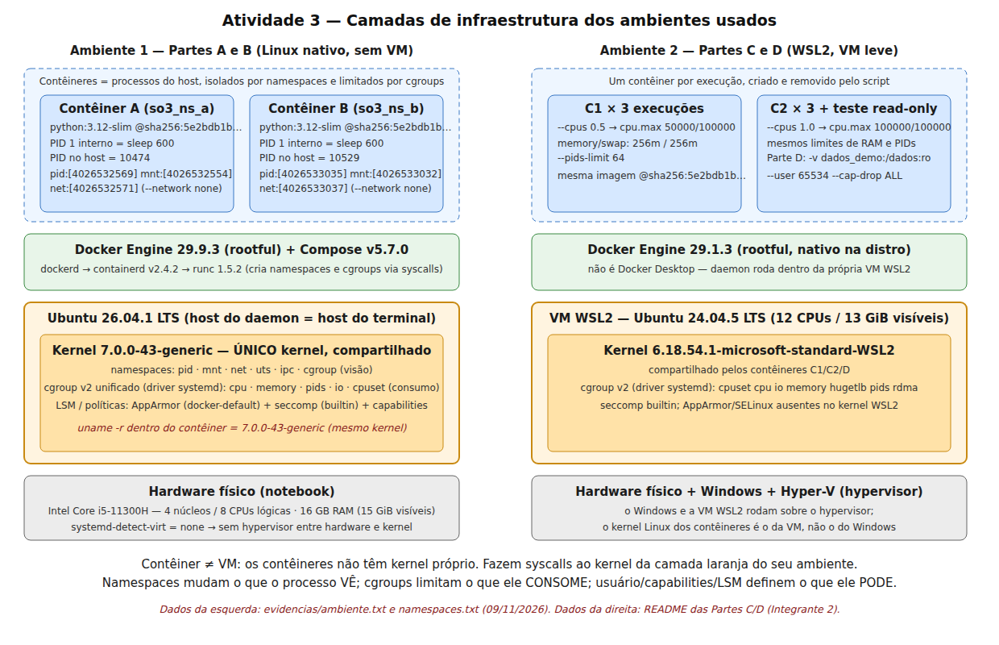

# Partes A e B — Ambiente e evidências de namespaces

Responsável pela coleta: **Antônio José Martins Mascarenhas** (Integrante 1).
Coleta em **09/11/2026**. Todos os valores abaixo foram copiados dos logs em [`../evidencias/`](../evidencias/).
Nenhum foi tirado de exemplo.

> **Para o Integrante 3:** a tabela comparativa e a explicação do PID 1 são sua parte. As seções 3 e 4
> trazem os dados já organizados e um rascunho que pode ser revisado ou reescrito.

## 1. Parte A — Ambiente

| Item | Valor | Fonte |
|---|---|---|
| Tipo de host do daemon | **Linux nativo**, sem VM, WSL2 ou Docker Desktop. O daemon roda no mesmo host do terminal. | `systemd-detect-virt = none`; `docker context` = `unix:///var/run/docker.sock` |
| Hardware | Intel Core i5-11300H, 4 núcleos / **8 CPUs lógicas**, VT-x | `lscpu`, `nproc` |
| RAM | 16 GB (15 GiB visíveis), swap 8 GiB | `free -h` |
| Distribuição | Ubuntu 26.04.1 LTS | `/etc/os-release` |
| Kernel | `7.0.0-43-generic` x86_64 (`PREEMPT_DYNAMIC`) | `uname -srvmo` |
| Docker | Engine **29.9.3** (rootful), containerd v2.4.2, runc 1.5.2 | `docker version` |
| Compose | v5.7.0 | `docker compose version` |
| cgroup | **v2** unificado (`cgroup2fs`), driver **systemd** | `docker info`, `stat -fc %T /sys/fs/cgroup` |
| Controladores (raiz) | `cpuset cpu io memory hugetlb pids rdma misc dmem` | `/sys/fs/cgroup/cgroup.controllers` |
| Segurança | AppArmor (`default`), seccomp (`builtin`), cgroupns | `docker info SecurityOptions` |
| Imagem | `python@sha256:5e2bdb1b0d542d5039cffb8181c65930093949194a65c365dfb1b0fe13a4fa5b` (`python:3.12-slim`) | `evidencias/imagem_digest.txt` |

**Verificação dos limites dentro de um contêiner** (`evidencias/controladores.txt`). Executado com as flags da condição C1
(`--cpus 0.5 --memory 256m --memory-swap 256m --pids-limit 64`), o próprio contêiner lê em `/sys/fs/cgroup`:
`cpu.max = 50000 100000`, `memory.max = 268435456`, `memory.swap.max = 0`, `pids.max = 64`.
A raiz vista é `0::/` (cgroup namespace privado). O `uname -r` dentro do contêiner retorna `7.0.0-43-generic`,
o mesmo kernel do host.

O digest é **idêntico** ao usado pelo Integrante 2 nas Partes C/D, então a imagem é a mesma nos dois ambientes.

### Atenção: dois ambientes diferentes

As Partes C/D foram executadas por outro integrante em **WSL2** (Ubuntu 24.04.5, kernel `6.18.54.1-microsoft-standard-WSL2`,
Docker 29.1.3, 12 CPUs). As Partes A/B foram executadas aqui, em **Linux nativo**. O relatório precisa deixar isso explícito:
o diagrama mostra os dois ambientes lado a lado. Os resultados de namespaces valem como mecanismo, mas os números de cgroups
se referem ao ambiente WSL2.

## 2. Diagrama



Fonte editável: [`../diagrama/infraestrutura.svg`](../diagrama/infraestrutura.svg).

## 3. Parte B — Dados brutos dos namespaces

Dois contêineres independentes da mesma imagem, ambos com `--network none --cap-drop ALL --security-opt no-new-privileges`
e o comando `sleep 600`. Log: [`../evidencias/namespaces.txt`](../evidencias/namespaces.txt).

| Campo | Contêiner A (`so3_ns_a`) | Contêiner B (`so3_ns_b`) |
|---|---|---|
| `PID_host` (docker inspect) | 10474 | 10529 |
| `/proc/1/comm` interno | `sleep` | `sleep` |
| `NSpid` no host (`/proc/<PID>/status`) | `10474 1` | `10529 1` |
| Processos visíveis dentro | `1 sleep`, `39 sh` (o próprio `docker exec`) | `1 sleep`, `39 sh` |
| Interfaces de rede visíveis | apenas `lo` | apenas `lo` |

### Rascunho da tabela comparativa (Integrante 3 revisa)

| Recurso | Handle em A | Handle em B | Host (PID 1/shell) | Iguais? | Interpretação |
|---|---|---|---|---|---|
| PID | `pid:[4026532569]` | `pid:[4026533035]` | `pid:[4026531836]` | Diferentes | Cada contêiner tem a própria árvore de PIDs. Dentro dele só aparecem os seus processos, numerados a partir de 1. |
| mount | `mnt:[4026532554]` | `mnt:[4026533032]` | `mnt:[4026531832]` | Diferentes | Cada contêiner tem a própria tabela de montagens (rootfs da imagem em overlay). Montar ou desmontar em um não aparece no outro. |
| network | `net:[4026532571]` | `net:[4026533037]` | `net:[4026531833]` | Diferentes | Pilhas de rede separadas. Com `--network none`, cada uma só tem `lo`, sem rota nem interface para o host. |

Os números entre colchetes são números de inode no `nsfs`. Dois processos estão no mesmo namespace **se e somente se**
o handle é igual (namespaces(7)).

## 4. PID 1 em ambos: dados para a explicação

- Dentro de A e dentro de B, `/proc/1/comm = sleep`. **Os dois contêineres têm um PID 1.**
- São processos **distintos** no kernel: no host, o PID 1 de A é **10474** e o de B é **10529**
  (`ps` no host mostra `sleep 600` com usuário root em ambos).
- A linha `NSpid: 10474 1` do `/proc/10474/status` é a prova direta: o **mesmo processo** tem PID 10474 no namespace PID do host
  e PID 1 no namespace PID filho. Um namespace PID novo começa a numeração em 1. O primeiro processo criado nele (o `init` do
  namespace) recebe o 1, mas continua tendo um PID “real” no namespace pai.
- Os handles `pid:[…]` diferentes confirmam que A e B estão em namespaces PID distintos. Por isso o número 1 pode se repetir sem conflito.
- O `sh` com PID 39 é o processo criado pelo `docker exec`, que entra (`setns`) no namespace já existente.
- Como o host do daemon é o próprio Linux nativo, foi possível conferir o PID do inspect no `/proc` do terminal.
  Em Docker Desktop ou WSL2 com daemon em outra VM, essa verificação não seria válida.

**O que essa evidência não prova:** não prova isolamento de segurança absoluto. Os contêineres compartilham o kernel, e uma
falha no kernel ou no runtime pode ultrapassar namespaces. Também não diz nada sobre limite de consumo (isso é cgroup)
nem sobre privilégios (usuário, capabilities, AppArmor/seccomp). Namespaces mudam o que o processo **vê**.

## 5. Reprodução

```bash
bash scripts/coleta_ambiente.sh     # Parte A: gera evidencias/ambiente.txt, imagem_digest.txt, controladores.txt
bash scripts/coleta_namespaces.sh   # Parte B: gera evidencias/namespaces.txt
```

Os scripts só leem `/proc` e `/sys`. `coleta_namespaces.sh` cria apenas `so3_ns_a` e `so3_ns_b` e os remove ao sair (`trap EXIT`).
Os handles e PIDs mudam a cada execução. Os valores acima são os desta coleta.
Limpeza manual, se interrompido: `docker rm -f so3_ns_a so3_ns_b`.
